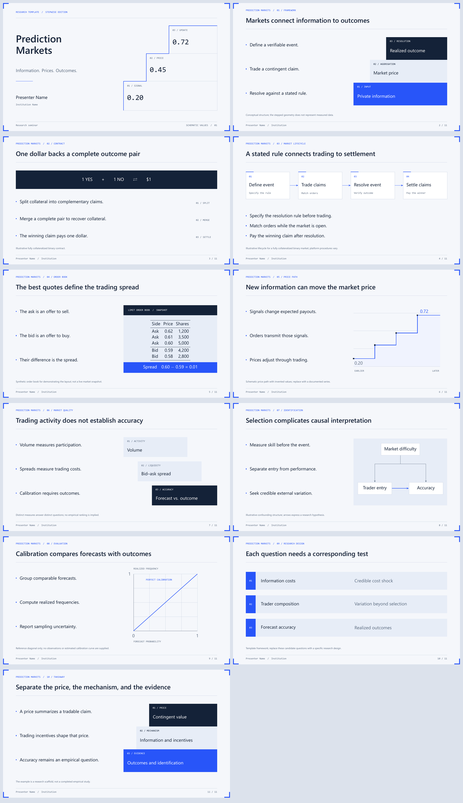

<div align="center">
  
  <h1>Prediction Markets</h1>
  <p><strong>A geometric Beamer recipe for prediction markets, information, and market design.</strong></p>
  <p><em>Information takes shape. Markets give it a price.</em></p>
  <p><strong>Contributor:</strong> Willie SONG</p>
</div>

## Downloads

[View full PDF](main.pdf) | [Download full PDF](main.pdf?raw=true) | [Browse source files](./)

The PDF contains the complete example presentation. To use the editable LaTeX template, download this repository with **Code > Download ZIP** on GitHub and open this recipe folder. Keep its supporting files together.

## Preview



## Inspiration

Prediction Markets draws on price ladders, order books, and the layered structure of a trading terminal. Stepped forms suggest information accumulating into a market price, while square modules give mechanisms and evidence a clear place on the page. A near-white canvas, navy text, and electric-blue accents keep the visual language precise and restrained. Four inward-facing corner brackets frame the presentation; the outlined numerical staircase gives the cover its identity.

## Best For

Economics and finance seminars, prediction-market introductions, market-design explanations, and research presentations about information aggregation, trading behavior, and forecast accuracy.

## Elements

| Layer | Element |
|-------|---------|
| Colors | Near-white canvas, navy text, electric-blue accents, and pale blue-gray panels |
| Fonts | Segoe UI body, Segoe UI Semibold titles, and Consolas numerical accents |
| Navigation | Section labels, author and institution footer, and page numbers |
| Structure | Square modules, stacked tiers, and four symmetrical inward-facing corner brackets |
| Bullets | Small blue squares with a consistent left-aligned text edge |
| Diagrams | Four-stage market lifecycle, causal diagram, price path, and calibration reference |
| Tables | Order-book example with a separate spread strip |
| Title page | Left-aligned typography and an open numerical staircase on a light background |

## Quick Start

Requires XeLaTeX and the Segoe UI, Segoe UI Semibold, and Consolas fonts installed on your system.

```bash
xelatex main.tex
xelatex main.tex
```

## File Structure

```text
PredictionMarket/
|-- beamerthemePredictionSteps.sty  # Shared theme and layout macros
|-- main.tex                       # Entry point and eleven example slides
|-- main.pdf                       # Compiled presentation
|-- fig/                           # Independent README symbol
|-- preview-contact-sheet.png      # Combined slide preview
|-- page-*.png                     # Individual slide previews
|-- VALIDATION.md                  # Compilation and visual-review notes
`-- README.md                      # Recipe documentation
```

## Customization

Edit the presenter, institution, and date in `main.tex`, then replace the example slides with your own material. The examples cover contract mechanics, a market lifecycle, an order book, price movements, and research design.

The theme uses 18 pt body text and 26 pt content titles. Keep bullets short and left-aligned; center figures and tables within their allocated regions. Split crowded slides instead of reducing the body font size.

To adjust the palette, edit `beamerthemePredictionSteps.sty`:

```latex
\definecolor{PMInk}{HTML}{142238}    % Main text
\definecolor{PMBlue}{HTML}{2855F9}   % Accent
\definecolor{PMPaper}{HTML}{F5F7FB}  % Near-white canvas
\definecolor{PMPanel}{HTML}{E7EDF7}  % Local panels
```

`PMpoint` controls bullet placement, `PMtier` creates a visual layer, and `PMcorners` draws the four matching corner ornaments. Keep the canvas white or near-white, including on the cover, and reserve stronger colors for local elements. Recompile and inspect the slides after changing content or layout.

Numerical examples are synthetic and labeled as illustrations. Replace them with documented data before presenting empirical findings.
