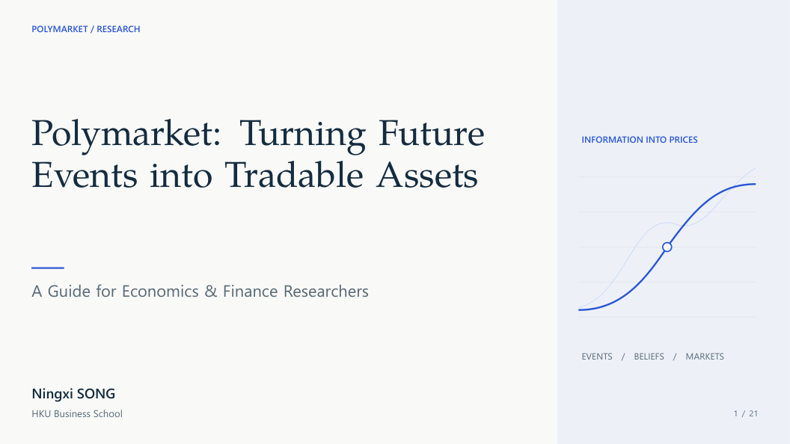

<div align="center">
  
  <h1>Prediction Market</h1>
  <p><strong>An editorial Beamer recipe for prediction markets, beliefs, and economic mechanisms.</strong></p>
  <p><em>Uncertainty invites a question. Markets give beliefs a price.</em></p>
  <p><strong>Contributor:</strong> Willie SONG</p>
</div>

## Preview


[View the complete PDF](main.pdf)

## Inspiration

Prediction Market takes its starting point from the Polymarket demonstration deck: future events become questions, and competing beliefs are expressed through trading. Its design treats that complexity with editorial restraint. Warm-white pages, ink-blue text, and a cobalt accent separate the argument from the surrounding detail; green and red distinguish YES and NO. The serif cover introduces the topic, while sans-serif content pages support the explanation of mechanisms and evidence. The cover curves are decorative, not empirical estimates.

## Best For

Economics and finance seminars, prediction-market introductions, market-design explanations, and research presentations about information aggregation and belief formation.

## Elements

| Layer | Element |
| --- | --- |
| Canvas | 16:9, 13.33 by 7.5 inches |
| Colors | Warm white `#FAFAF7`, ink `#152C40`, body `#24394A`, cobalt `#2856D8` |
| Secondary colors | Slate `#586A78` and panels `#EEF2F7` |
| YES / NO | Dark green `#13775D` and muted red `#B9454E` |
| Fonts | TeX Gyre Pagella cover; Segoe UI body with TeX Gyre Heros fallback |
| Type sizes | Cover 44/51 pt; body 20/27 pt; headings 30/36 pt; tables 18/23 pt |
| Navigation | Automatic folios and an understated footer |
| Blocks | Flat tinted callouts and quiet highlight panels |
| Margins | 1.35 cm |

Segoe UI falls back to TeX Gyre Heros on other systems; font files are not redistributed.

## Quick Start

Run twice from this directory:

```powershell
xelatex -interaction=nonstopmode -halt-on-error main.tex
xelatex -interaction=nonstopmode -halt-on-error main.tex
```

XeLaTeX and the TeX Live packages fontspec, TikZ, tcolorbox, booktabs and anyfontsize are required.
The second pass resolves overlay positions and the total page count.

## File Structure

```text
PredictionMarket/
|-- README.md
|-- main.tex                   # Metadata and content includes
|-- polymarket.cls             # Widescreen Beamer class
|-- beamerthemePolymarket.sty   # Typography, palette, and components
|-- content/                   # 21-slide demonstration deck
|   |-- mechanism.tex
|   |-- literature.tex
|   |-- foundations.tex
|   |-- contributions.tex
|   `-- synthesis.tex
|-- main.pdf                   # Compiled preview
|-- page01.png ... page21.png   # Rendered slide previews
`-- preview-contact-sheet.png  # Combined preview
```

## Customization

Edit the metadata in `main.tex`, then replace the sections in `content/`. The sample deck retains its supplied presenter information, which is separate from the recipe contributor above.

Use a top-aligned frame, then `\pmheader{SECTION}{legacy page label}`, `\pmtitle{Short heading}` and `pmbody`.
The second header argument is accepted for compatibility but ignored: actual frame counts are automatic.
Keep headings to one line. `pmbody` is 13.6 cm high by default and accepts an optional custom height.
Keep body text at 20 pt and restructure dense slides into columns rather than shrinking text.
`pmcallout` supports an optional title; `pmkey` provides a quiet highlight panel.
The cover reads standard title metadata rather than hardcoded author/title strings.
The cover curves are decorative; they are not empirical estimates.

After changes, compile the PDF and refresh both the per-slide previews and the contact sheet.

## Provenance

This folder contains the supplied editorial redesign dated 22 October 2026. Its previous documentation referenced a before/after archive outside this repository. That external archive is not included here and is not required to compile the template.

The demonstration's substantive research and platform claims were not independently updated or fact-checked during this documentation pass. Verify them and replace sample material before presenting.
