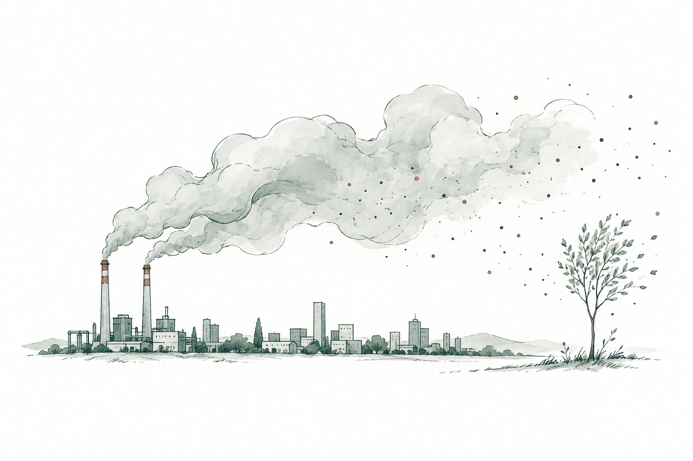
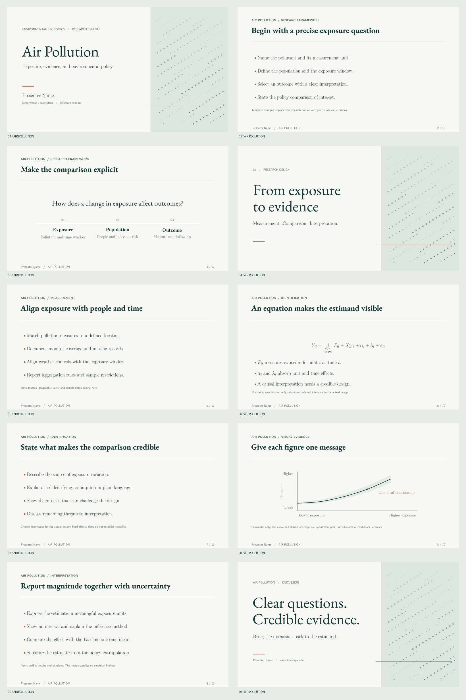

<div align="center">
  
  <h1>Air Pollution</h1>
  <p><strong>A restrained Beamer recipe for environmental economics, exposure, and policy research.</strong></p>
  <p><em>Make the invisible visible. Let the evidence breathe.</em></p>
  <p><strong>Contributor:</strong> Willie SONG</p>
</div>

## Preview



[View the complete PDF](main.pdf)

## Inspiration

Air Pollution takes its visual cue from particles suspended in the air: individually small, collectively consequential. A field of fine dots gives that idea a visible form, while mist-white space and deep green typography keep the research in focus. Copper marks the point that deserves attention. Adapted from the earlier Sharp Academic recipe, the design retains its serif academic character while giving it an environmental identity.

## Best For

Environmental economics seminars, pollution-exposure studies, and policy presentations that need room for equations, identification arguments, and carefully annotated evidence.

## Elements

The cover, section divider, and closing slide pair an open editorial text area with a full-height particle field. Content slides use a consistent heading, a fine rule, widely spaced bullets, and a quiet page counter. The particle pattern is deterministic vector artwork drawn in TikZ; no external images, fonts, or online services are required at compile time beyond the installed LaTeX packages.

| Element | Specification |
| --- | --- |
| Canvas | 16:9, approximately 28.444 × 16 cm |
| Headings | EB Garamond; 56 pt cover and 29 pt frame titles |
| Body and mathematics | Latin Modern; 18 pt body text |
| Metadata | Small sans-serif labels, 11 pt |
| Background | Mist white `#F7F8F3` |
| Primary ink | Deep green `#183B39` |
| Body | Charcoal green `#293D3B` |
| Secondary text | Muted green `#60716B` |
| Rules and atmospheric panel | Pale sage `#DBE4DD` |
| Accent | Copper `#A75C3B` |
| Navigation | Author, theme name, and current / total frame count on content slides |

## Quick Start

Use a LaTeX distribution with Beamer, Latin Modern, EB Garamond, AMS mathematics, microtype, and PGF/TikZ installed. The supplied output was built with pdfLaTeX from TeX Live 2024.

Run from this folder:

```bash
pdflatex -interaction=nonstopmode -halt-on-error main.tex
pdflatex -interaction=nonstopmode -halt-on-error main.tex
```

Both passes matter: the second resolves the page counter and the page-anchored particle artwork. The output is `main.pdf`. No shell escape is needed.

## File Structure

```text
air-pollution/
|-- README.md
|-- main.tex                 # Current editable template
|-- main.pdf                 # Current compiled ten-slide deck
|-- page01.png ... page10.png # Current catalog previews
|-- previews/overview.png    # Contact sheet for documentation
|-- fig/air-pollution-sketch.png # README introduction illustration
|-- VALIDATION.md            # Build and visual inspection notes
`-- original/                # Preserved Sharp Academic source and assets
```

## Customization

Edit `\title`, `\subtitle`, `\author`, `\institute`, and `\date` in `main.tex`. The optional short author appears in the footer. Edit the closing contact address separately. Replace the ten sample frames with your talk, and change `\chapterlabel` for the running topic label.

The palette, typography, margins, footer, and `\atmosphere` artwork are defined near the top of the source. Keep content titles on one line and use three or four concise bullets. Use copper for a focal coefficient or annotation, and reserve the particle field for structural slides.

After compiling, regenerate the root-level slide previews from the final PDF. With Poppler installed:

```bash
pdftoppm -png -r 144 main.pdf page
```

Rename the resulting `page-01.png` through `page-10.png` to `page01.png` through `page10.png`, replacing the previous previews. Update `previews/overview.png` if the slide sequence changes.

## Included Slides

1. Title and presenter information.
2. Motivation and exposure definition.
3. Research question, population, and outcome.
4. Section divider: from exposure to evidence.
5. Measurement and data alignment.
6. An illustrative panel regression specification.
7. Identification assumptions and diagnostics.
8. A schematic figure with a focal relationship.
9. Guidance for reporting magnitude and uncertainty.
10. Closing discussion slide.

The sample is a research presentation scaffold, **not an empirical study**. It contains no estimated pollution effects. The curve and shaded envelope on slide 8 are schematic styling examples, not observations, estimates, or confidence intervals. Replace example text, figures, and notes with your own documented evidence.

## Provenance

This recipe replaces the local `sharp-academic` folder. The supplied files are preserved unchanged under `original/`; their descriptions and previews document the earlier design only. The current recipe replaces the monochrome palette, calligraphic bullets, and pebble progress row with the visual system described above.

The catalog discovers this folder automatically. Its application remains read-only; compilation and preview preparation happen separately from the catalog.
