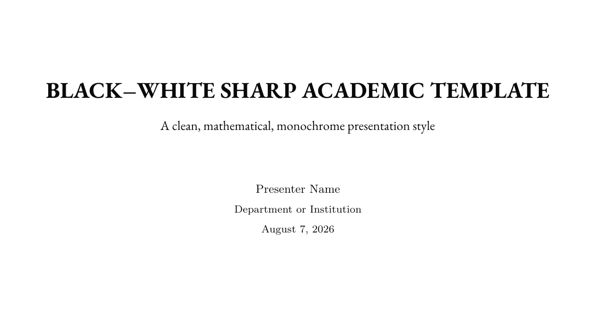

<div align="center">
  <h1>Sharp Academic</h1>
  <p><strong>A standalone, sharp, monochrome Beamer template for clean academic talks.</strong></p>
  <p><em>Black-and-white, classical serif headings, Latin Modern body, fountain-pen bullets, no decorative noise.</em></p>
</div>

## Preview



## Design

Sharp Academic is a deliberately minimal black-and-white Beamer theme. It drops color entirely and relies on weight, geometry, and whitespace for hierarchy. The character comes from two choices:

- **Classical serif headings**: EB Garamond for titles, frame titles, and block titles; Latin Modern Roman for body text and Latin Modern Math for equations.
- **Fountain-pen stroke bullets** and **thin gray rules** as the only recurring motif — no diamonds, logos, or backgrounds.

## Best For

Research talks, seminar presentations, and any deck that must print cleanly in black-and-white and survive being projected in a plain room.

## Elements

| Layer | Element |
|-------|---------|
| Colors | Strict monochrome: white background, near-black structure, light-gray rules/blocks |
| Fonts | EB Garamond (titles/headings) + Latin Modern Roman (body) + Latin Modern Math (equations) |
| Navigation | Page-number footer only; no navigation symbols |
| Blocks | Stark black title bar with white text; light-gray body |
| Bullets | Fountain-pen stroke bullets (item / subitem / subsubitem) |
| Progress | Dotted progress indicator above each content frame: small dots with a larger dot at the current slide |
| Title page | Centered text, no decorative accents |
| Section divider | Centered title framed by two thin gray rules |

## Quick Start

This is a self-contained template — it does **not** depend on BeamerForge's registry, generator, or fonts. Only standard LaTeX packages are used.

```bash
pdflatex main.tex
pdflatex main.tex   # second pass resolves page references
```

`xelatex` also works if preferred.

## File Structure

```text
sharp-academic/
|-- main.tex               # Self-contained template with replaceable metadata
|-- sharp-academic.pdf     # Compiled output
|-- mockup.svg             # Vector style mockup (title / content / divider / equation)
|-- page*.png              # Rendered preview of each slide
`-- README.md              # This file
```

## Customization

Edit the metadata block in `main.tex`:

```latex
\title{...}
\subtitle{...}
\author{...}
\institute{...}
\date{...}
```

Then replace the sample frames (`\section` / `\begin{frame}` blocks) with your own content. The design is fully defined at the top of `main.tex`, so you can tweak palette hex values, the pen bullet shape, or the heading font family in one place.
