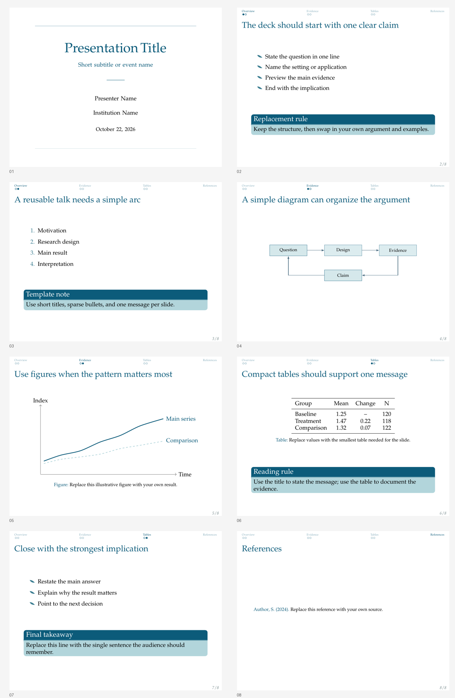

<div align="center">
  
  <h1>Bamboo</h1>
  <p><strong>A reusable Beamer recipe adapted from the original Bamboo template.</strong></p>
  <p><em>Clean, concise, and suited for clear analytical presentations.</em></p>
  <p><strong>Contributor:</strong> Willie SONG</p>
</div>

## Preview



## Inspiration

Bamboo is inspired by Chinese landscape painting, especially the crisp, upright, and forceful presence of bamboo in ink compositions. The template translates that spirit into a clean academic structure: restrained color, clear hierarchy, light visual weight, and a concise rhythm suited for arguments that should feel fresh and firm.

## Best For

Research talks, policy briefings, concept pitches, and analytical presentations that need a restrained academic layout with a clear navigation header.

## Elements

| Layer | Element |
|-------|---------|
| Colors | Deep teal titles and block headers, pale teal block bodies, and medium teal list markers |
| Fonts | Palatino serif body text |
| Navigation | Miniframes header, page-number footer |
| Blocks | Rounded Beamer blocks in normal, example, and alert styles |
| Bullets | Full willow-leaf markers pointing down-right, with matching numbered lists |
| Title page | Centered typography with restrained horizontal rules |

## Quick Start

```bash
xelatex main.tex
biber main
xelatex main.tex
xelatex main.tex
```

## File Structure

```text
bamboo/
|-- bamboo.cls          # Theme class adapted from the original template
|-- main.tex            # Entry point with replaceable metadata
|-- content/            # Replaceable slide sections
|   |-- overview.tex
|   |-- figures.tex
|   `-- tables.tex
|-- fig/                # README image and optional title images
|-- preview-contact-sheet.png  # Combined slide preview
|-- page*.png           # Rendered preview images
|-- references.bib      # Sample bibliography
`-- README.md           # Recipe documentation
```

## Customization

Edit the metadata in `main.tex`, then replace the files in `content/` with your own slides.

The title page uses a centered title, subtitle, presenter, institution, and date, with fine horizontal rules rather than literal botanical decoration.

The color hierarchy uses deep teal (`#0C5B7A`) for titles and block headers, pale teal (`#B2D5DB`) for block bodies, and medium teal (`#397C90`) for leaf and numbered list markers. Block headers use white text; body text remains black.

The included `fig/bamboo-white.png` is the inspiration image for this README, not a required slide background.
