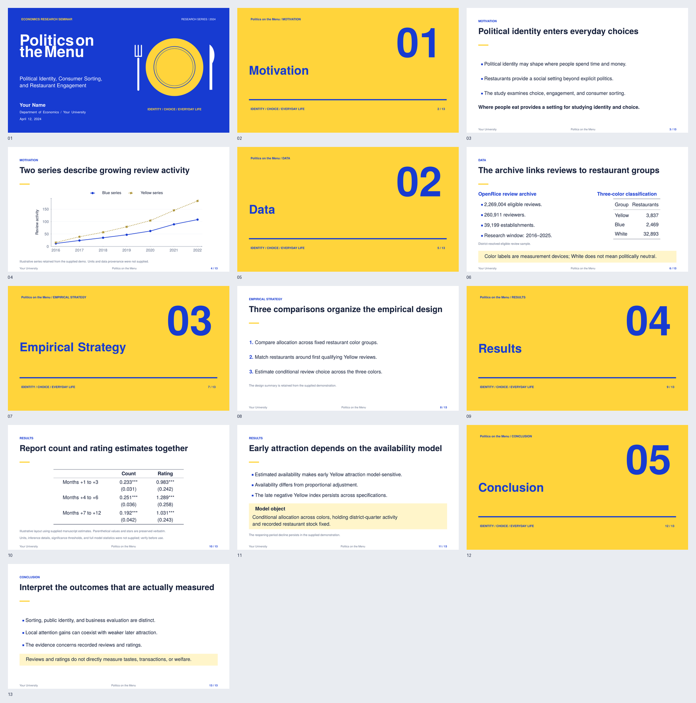

<div align="center">
  
  <h1>Blue Yellow</h1>
  <p><strong>An academic Beamer recipe shaped by blue-yellow confrontation, political identity, and everyday choices.</strong></p>
  <p><em>Opposing colors. Contested identities. Evidence in the space between.</em></p>
  <p><strong>Contributor:</strong> Willie SONG</p>
</div>

## Downloads

[View full PDF](main.pdf) | [Download full PDF](https://raw.githubusercontent.com/Ningxi-Song/BeamerForge-codex/main/recipes/blue-yellow/main.pdf) | [Browse source files](./)

The PDF contains the complete example presentation. To use the editable LaTeX template, download this repository with **Code > Download ZIP** on GitHub and open this recipe folder. Keep its supporting files together.

## Preview



[View the component gallery](previews/components.png)

## Inspiration

Blue Yellow originates in the creator's interpretation of confrontation during Hong Kong's political unrest. Blue and yellow carry the central meaning of the template: opposing political identities and the tension that reaches into everyday economic choices. **Politics on the Menu** places those questions in the setting of restaurants and consumer behavior; the cafe illustration above recalls that research setting.

The **Counterpoint** edition expresses that tension through paired lines that stop short of meeting, slight shifts in alignment, and contrasting typographic voices. Blue and ochre-yellow function as marginal marks and analytical accents. All pages have white backgrounds; headings, not color fields, lead the reading order.

Charter gives titles and block headings a distinctive serif structure. Source Sans Pro carries body text, numbers, captions, and diagram labels. The cover uses a generous left-aligned title, an interrupted baseline, and a pair of offset marginal strokes. Chapter pages repeat the baseline at a smaller scale.

The same vocabulary extends to reusable academic elements: a four-stage workflow, three kinds of Beamer block, a two-column analytical comparison, a trend chart, and a regression table. These elements demonstrate the theme beyond its cover.

## Best For

Political economy seminars, consumer-behavior research, and presentations about identity, social interaction, and everyday economic choices.

## Elements

| Layer | Element |
| --- | --- |
| Canvas | 16:9 widescreen |
| Colors | Slate blue `#344F73`, ochre-yellow `#B79740`, ink `#252A31`, and white |
| Fonts | Charter titles and block headings; Source Sans Pro body and numbers; Latin Modern mathematics |
| Navigation | Small sans-serif section labels, hairline separators, and configurable footers |
| Blocks | White blocks with blue, ochre, or ink side rules; no tinted panels |
| Title page | Charter title, interrupted baseline, and two small offset marginal strokes |
| Section dividers | Italic chapter numbers, serif headings, and offset blue-yellow rules |
| Diagrams | Outlined workflow nodes, consistent arrowheads, and reusable TikZ styles |
| Comparison | Two text columns with slightly offset blue-yellow rules |
| Evidence | Full-width trend chart and a separate, spacious results table |
| Example | 16 slides, including five chapter dividers and three component examples |
| Theme name | `PoliticsMenu`; the catalog folder is `blue-yellow` |

## Quick Start

Run from this folder with a LaTeX distribution containing Beamer, TikZ, PGFPlots, booktabs, colortbl, tcolorbox, XCharter, Source Sans Pro, and Latin Modern:

```bash
pdflatex -interaction=nonstopmode -halt-on-error demo.tex
pdflatex -interaction=nonstopmode -halt-on-error demo.tex
```

Alternatively, use `latexmk -pdf demo.tex`. The source entry point remains `demo.tex` and produces `demo.pdf`. The catalog copy is named `main.pdf`; refresh it from `demo.pdf` after recompiling, then regenerate the PNG previews.

## File Structure

```text
blue-yellow/
|-- README.md
|-- beamerthemePoliticsMenu.sty # Theme and reusable commands
|-- demo.tex                   # Editable example and metadata
|-- demo.pdf                   # Redesigned compiled example
|-- main.pdf                   # Same PDF under the catalog filename
|-- page*.png                  # Rendered slide previews
|-- preview-contact-sheet.png  # Combined preview
|-- VALIDATION.md             # Rendering and verification notes
|-- previews/components.png   # Cover, workflow, blocks, and comparison gallery
|-- original/                 # Preserved original source, PDF, README, and assets
`-- assets/
    |-- cafe_left.png          # README introduction illustration
    `-- menu_corner.png        # Preserved original artwork
```

## Customization

Edit the title, subtitle, author, institution, and date in `demo.tex`, then replace its example frames with your own research. The following minimal example uses the theme's existing metadata commands. Keep the title frame plain and keep the cover title concise.


```tex
\documentclass[aspectratio=169,11pt]{beamer}
\usetheme{PoliticsMenu}

\title[Politics on the Menu]{Politics on\\the Menu}
\subtitle{Political Identity, Consumer Sorting,\\and Restaurant Engagement}
\author{Your Name}
\institute[Your University]{Department of Economics\\Your University}
\date{April 12, 2024}
\PMseminar{Economics Research Seminar}
\PMtopright{Economics Research Seminar\quad\textbar\quad Spring 2024}

\begin{document}
\begin{frame}[plain]\titlepage\end{frame}
\section{Motivation}
\begin{frame}{Motivation}
Your content.
\end{frame}
\end{document}
```

### Useful theme commands

- `\PMseminar{...}` - seminar name on the title slide.
- `\PMtopright{...}` - small metadata at the lower-right corner of the title slide.
- `\PMleftfooter{...}` and `\PMcenterfooter{...}` - footer labels.
- `\PMsectiontagline{...}` - section-divider subtitle.
- `\PMassetpath{path/}` - retained for compatibility; the new artwork needs no external image assets.
- Theme option `nosectionpages` disables automatic section-divider slides.

Adjust the `PMBlue`, `PMYellow`, and `PMInk` definitions in the theme to change its palette. The cover and chapter dividers use fixed text positions, so keep headings concise and check the rendered output after changing text. The original edition is preserved in `original/`; compile its `demo.tex` from that folder to reproduce it.

The supplied review counts, trend coordinates, and regression entries are preserved. The chart and result table now occupy separate slides; the example explicitly identifies missing units and inference details instead of inventing them.

Replace demonstration numbers, dates, and research statements with your own verified material before presenting.


### Reusable blocks

The standard Beamer environments use the same white background and typographic hierarchy. Blue marks a definition, ochre marks a condition or caution, and ink marks an interpretation. Labels identify their role even when printed in grayscale.

```tex
\begin{block}{Definition}
Define the measured object.
\end{block}

\begin{alertblock}{Identifying assumption}
State the condition needed for the interpretation.
\end{alertblock}

\begin{exampleblock}{Interpretation}
Explain what the evidence supports.
\end{exampleblock}
```

Use `PMtakeaway` for a short untitled conclusion. For an explicit title and custom rule color, use `\begin{PMblock}[PMYellow]{Your heading}`. Keep each block concise and inspect its height after editing.

### Workflow diagrams

The theme loads TikZ's `positioning` and `arrows.meta` libraries and defines `PMflow`, `PMarrow`, and `\PMstep{label}{text}`. Nodes have consistent widths and minimum heights for short labels; do not shrink the whole diagram to fit longer prose.

```tex
\begin{center}
\begin{tikzpicture}
  \node[PMflow] (source) {\PMstep{01 / SOURCE}{Review records}};
  \node[PMflow,right=1cm of source] (sample)
    {\PMstep{02 / SAMPLE}{Eligible reviews}};
  \draw[PMarrow] (source.east) -- (sample.west);
\end{tikzpicture}
\end{center}
```

Pages 9–11 of `main.pdf` show the four-stage workflow, all three block types, and a two-column comparison. Copy the corresponding frames from `demo.tex` for editable examples. These additions organize the supplied research statements; the schematic arrows are not new causal claims.
