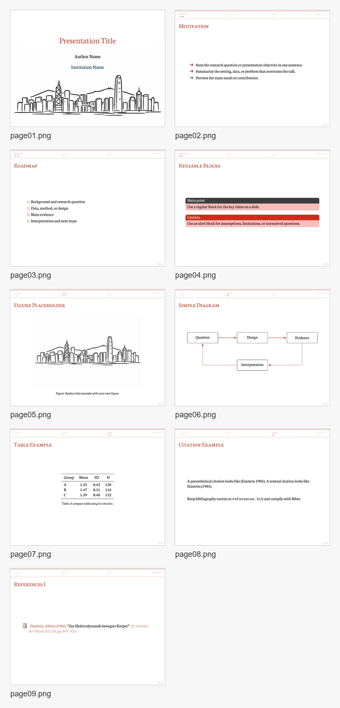

<div align="center">
  
  <h1>D Rose</h1>
  <p><strong>Black-red Beamer recipe for narratives of tension, resilience, and contrast.</strong></p>
  <p><em>In the midst of oppression, we bloom.</em></p>
  <p><strong>Contributor:</strong> Willie SONG</p>
</div>

## Downloads

[View full PDF](main.pdf) | [Download full PDF](https://raw.githubusercontent.com/Ningxi-Song/BeamerForge-codex/main/recipes/d-rose/main.pdf) | [Browse source files](./)

The PDF contains the complete example presentation. To use the editable LaTeX template, download this repository with **Code > Download ZIP** on GitHub and open this recipe folder. Keep its supporting files together.

## Preview



## Inspiration

Derrick Rose -- youngest NBA MVP, a career of breathtaking highs and devastating injuries. His logo, a rose blooming from the letter "D", encodes the paradox that drives this design: **oppression and blooming coexist, prosperity and regret are inseparable.**

## Best For

Narratives built around polarities, contradictions, and dual forces: social inequality, urban polarization, crisis and resilience, or any topic where two opposing truths must be held at once.

## Elements

| Layer | Element |
|-------|---------|
| Colors | Red-black primary (RGB 186,84,68), white background |
| Fonts | Neuton serif (bundled) |
| Navigation | Soft miniframes header, page-number footer |
| Blocks | 2 types -- normal (dark gray / light red) + alert (red / light red) |
| Bullets | Pifont ding 220/216 |
| Title page | Full-width skyline background with centered title text |

## Quick Start

```bash
xelatex main.tex
biber main
xelatex main.tex
xelatex main.tex
```

## File Structure

```text
d-rose/
|-- d-rose.cls          # Theme class
|-- main.tex            # Entry point with replaceable metadata
|-- main.pdf            # Complete compiled presentation
|-- content/            # Replaceable slide sections
|   |-- overview.tex
|   |-- figures.tex
|   `-- tables.tex
|-- fig/                # Images
|-- font/               # Bundled Neuton fonts
|-- preview-contact-sheet.png  # Combined slide preview
|-- page*.png           # Rendered preview images
|-- references.bib      # Sample bibliography
`-- README.md           # Recipe documentation
```

## Customization

Edit the metadata in `main.tex`, then replace the files in `content/` with your own slides.

To change the title-page background, replace `fig/hkskyline.png` with your own image.

To adjust the color palette, edit `d-rose.cls`:

```latex
\definecolor{redblack}{RGB}{186,84,68}     % Primary color
\definecolor{titleTextColor}{RGB}{1,49,78} % Structure color
```
